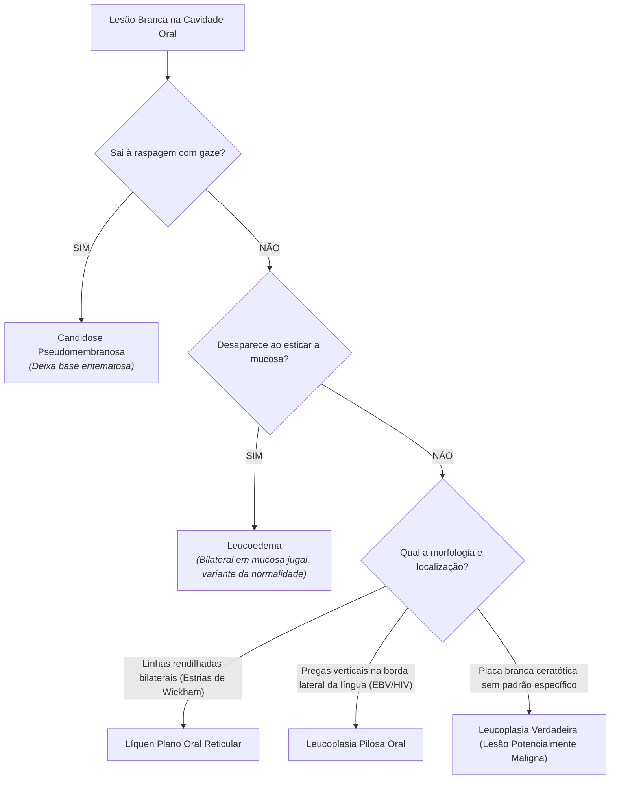

# 📚 Guia Prático de Semiologia e Diagnóstico de Lesões Orais
> **Material de Apoio e Raciocínio Clínico para a Prova Prática Projetiva**  
> *Cátedra de Semiologia e Estomatologia Odontológica*

---

## 🎯 O Método dos 4 Passos: Como Matar a Hipótese Diagnóstica em 30 Segundos

Na prova prática projetiva, o professor projeta a lâmina e você tem poucos segundos para avaliar a peça. Para nunca travar na **Hipótese Diagnóstica**, siga sempre este fluxo mental estruturado:

```
[1. Lesão Fundamental] ➔ [2. Sítio Anatômico] ➔ [3. Cor & Consistência] ➔ [4. Critério de Desempate]
```

1. **Qual é a Lesão Fundamental?**
   - É sólida elevada? ➔ **Nódulo** ou **Pápula**.
   - É elevada de conteúdo líquido? ➔ **Bolha** (> 3 mm) ou **Vesícula** (< 3 mm).
   - É plana, sem alteração de relevo (apenas cor)? ➔ **Mancha ou Mácula**.
   - É elevada, achatada, em platô? ➔ **Placa**.
   - É perda de substância ultrapassando o epitélio? ➔ **Úlcera**.
   - É perda superficial só de epitélio? ➔ **Erosão**.

2. **Onde está a lesão? (Topografia é 50% do Diagnóstico!)**
   - **Gengiva / Papila interdental**: Pense na *Tríade Reacional da Gengiva* (Granuloma Piogênico, LPCG, Fibroma Ossificante).
   - **Lábio inferior**: Mucocele (se translúcida/azulada e macia), Úlcera Traumática (se com fibrina central), Hemangioma (se arroxeada/vermelha compressível).
   - **Assoalho bucal**: Rânula (mucocele gigante do soalho) ou Tatuagem por Amálgama (se mancha escura plana).
   - **Borda lateral de língua**: Leucoplasia Pilosa (se placa estriada vertical) ou Úlcera Traumática / CEC (se borda endurecida).
   - **Dorso de língua (terço posterior / forame cego)**: Tireoide Lingual.
   - **Mucosa jugal bilateral**: Leucoedema (leitosa que some à tração) ou Líquen Plano (reticular com Estrias de Wickham).

3. **Qual a Consistência e Comportamento à Palpação?**
   - **Macia / Flutuante**: Contém muco ou líquido (Mucocele, Rânula).
   - **Compressível (esvazia à pressão)**: Vascular (Hemangioma).
   - **Pastosa / Mole gordurosa**: Adiposa (Lipoma).
   - **Firme / Fibroelástica**: Tecido conjuntivo denso fibroso (Hiperplasia Focal / Fibroma Traumático).
   - **Endurecida / Consistência óssea**: Formação mineralizada interna (Fibroma Ossificante Periférico) ou base de neoplasia maligna (CEC).

4. **Qual o Teste Semiológico Decisivo (Pulo do Gato)?**
   - *Diascopia / Vitropressão positiva* (clareia à pressão com lâmina de vidro) ➔ **Hemangioma**.
   - *Desaparece ao tracionar/esticar o tecido* ➔ **Leucoedema**.
   - *Destacável à raspagem com gaze (deixa fundo eritematoso)* ➔ **Candidose Pseudomembranosa**.
   - *NÃO destacável à raspagem com gaze* ➔ **Leucoplasia** ou **Leucoplasia Pilosa**.

---

## 🥊 As Grandes "Batalhas" da Prova: Como Desempatar os Diagnósticos Diferenciais

### Batalha 1: Os 3 Nódulos Reacionais da Gengiva (A Tríade da Papila Interdental)
Muito frequente na prova! As três lesões aparecem na gengiva marginal/papilar como nódulos decorrentes de irritação local (cálculo, placa bacteriana ou restauração desadaptada).

| Critério | Granuloma Piogênico | Lesão Periférica de Células Gigantes (LPCG) | Fibroma Ossificante Periférico |
| :--- | :--- | :--- | :--- |
| **Lesão Fundamental** | Nódulo | Nódulo | Nódulo |
| **Cor Típica** | **Vermelho vivo / Eritematoso brilhante** | **Arroxeado / Vermelho-escuro / Castanho** | **Róseo / Pálido** (semelhante à gengiva normal) |
| **Consistência** | Macia, esponjosa, friável | Firme a macia | **Firme a endurecida** (ao toque lembra consistência óssea) |
| **Sangramento** | **Sangra com extrema facilidade** ao toque leve | Pode sangrar, mas menos que o Granuloma | Raramente sangra |
| **Exclusividade** | Pode ocorrer fora da gengiva (lábio, língua) | **Exclusiva da gengiva / rebordo alveolar** | **Exclusiva da gengiva** |
| **Histopatologia (Pulo do Gato)** | Tecido de granulação com muitos capilares | Células gigantes multinucleadas + hemossiderina | Matriz osteoide / trabéculas ósseas mineralizadas |

> [!TIP]
> **Regra de Ouro da Cátedra**:
> - Se é **vermelho e sangra fácil** ➔ **Granuloma Piogênico**.
> - Se é **arroxeado/escuro** (por hemossiderina) ➔ **LPCG**.
> - Se é **róseo e duro/firme** (por osso interno) ➔ **Fibroma Ossificante Periférico**.

---

### Batalha 2: Os Nódulos de Lábio Inferior e Mucosa Jugal
| Critério | Mucocele | Lipoma | Hiperplasia Focal (Fibroma) | Hemangioma |
| :--- | :--- | :--- | :--- | :--- |
| **Lesão Fundamental** | Bolha / Nódulo de conteúdo líquido | Nódulo sólido | Nódulo sólido | Nódulo vascular |
| **Cor** | Azulada / Translúcida / Rósea | **Amarelada** ou avermelhada translúcida | **Rósea** (cor da mucosa normal) | **Avermelhada viva ou arroxeada/azulada** |
| **Consistência** | **Flutuante** à palpação (cheia de muco) | **Mole**, pastosa | **Firme / Fibroelástica** | Macia e **compressível** |
| **Pulo do Gato** | História de mordedura no lábio; extravasamento de muco | Constituído por adipócitos maduros; flutua em formol | Atrito crônico de dente/cúspide na linha de oclusão | **Vitropressão (diascopia) positiva**: isquemia instantânea |

---

### Batalha 3: O Dilema das Lesões Brancas (Raspa x Não Raspa x Desaparece)
As lesões brancas são o terror dos alunos se você não memorizar a dinâmica física delas:



---

### Batalha 4: Úlceras da Cavidade Oral
| Critério | Úlcera Traumática | Afta (Estomatite Aftosa Recorrente) | Carcinoma Epidermoide (CEC) |
| :--- | :--- | :--- | :--- |
| **Lesão Fundamental** | Úlcera | Úlcera | Úlcera ou Úlcero-vegetante |
| **Fundo da Lesão** | Fundo amarelado fibrinoso | Fundo amarelado/acinzentado plano | Fundo necrótico irregular, sujo |
| **Bordas** | Bordas eritematosas, **flexíveis / macias** | **Halo eritematoso vermelho vivo**, bem delimitado | **Bordas elevadas, evertidas e ENDURECIDAS** |
| **Causa / História** | Fator mecânico claro (dente quebrado, prótese, mordida) | História de surtos recorrentes; mucosa móvel | Tabagismo + Etilismo crônico; **não cicatriza em > 15 dias** |
| **Evolução** | Cicatriza rapidamente (7 a 14 dias) após remover o trauma | Auto-limitada (7 a 10 dias) | Progressiva, indolor no início, invasiva |

---

### Batalha 5: Manchas Escuras (Pigmentações Melânicas vs Amálgama)
| Critério | Tatuagem por Amálgama | Melanoma Oral | Mácula Melanótica / Pigmentação Racial |
| :--- | :--- | :--- | :--- |
| **Lesão Fundamental** | Mancha ou Mácula | Mancha que evolui para placa/nódulo | Mancha ou Mácula |
| **Cor** | Azulada, acinzentada ou enegrecida | Castanha a preta heterogênea (múltiplas cores) | Castanha homogênea |
| **Limites** | Bem delimitada ou difusa | **Irregulares, assimétricos, mal definidos** | Regulares |
| **Sítio Típico** | Próximo a restaurações antigas de amálgama ou leito de exodontia | Palato duro e gengiva | Gengiva inserida bilateral ou lábio |
| **Evolução** | Estacionária, assintomática por anos | **Crescimento rápido**, sangramento, ulceração | Estável |
| **Raio-X** | Frequentemente revela partículas radiopacas metálicas | Sem partículas radiopacas | Normal |

---

## 📋 Catálogo Completo das 28 Patologias da Cátedra (Fichas Rápidas de Bolso)

### 1. Mucocele
- **Hipótese:** Mucocele (Fenômeno de Extravasamento de Muco).
- **Lesão Fundamental:** Bolha (elevação de conteúdo líquido).
- **Sítio Principal:** Lábio inferior (quase exclusivo), face interna.
- **Cor & Consistência:** Translúcida/azulada, macia e **flutuante** à palpação.
- **Diferenciais:** Hiperplasia focal (é firme e rósea), Hemangioma (esvazia à pressão), Lipoma (é amarelado).
- **⚠️ Alerta da Prova:** Mucocele em lábio superior é raríssima! Se aparecer no lábio superior, suspeite de neoplasia de glândula salivar (Adenoma Pleomórfico).

### 2. Rânula
- **Hipótese:** Rânula.
- **Lesão Fundamental:** Bolha (aumento volumétrico translúcido).
- **Sítio Principal:** **Assoalho bucal** (unilateral, ao lado do freio lingual).
- **Cor & Consistência:** Azulada/arroxeada translúcida, flutuante.
- **Diferenciais:** Cisto dermoide (linha média, consistência pastosa), Linfangioma, Mucocele de glândula menor.
- **⚠️ Alerta da Prova:** A localização patognomônica da rânula é o **assoalho bucal** (relacionada ao ducto de Wharton ou glândula sublingual).

### 3. Papiloma Escamoso Oral
- **Hipótese:** Papiloma Escamoso Oral.
- **Lesão Fundamental:** Nódulo.
- **Sítio Principal:** Palato mole, úvula, língua ou lábio.
- **Aspecto Típico:** **Superfície verrugosa** com projeções digitiformes (aspecto de couve-flor), base pediculada (haste estreita).
- **Cor & Consistência:** Esbranquiçada (devido à ceratinização) ou rósea; firme/fibroelástica.
- **Diferenciais:** Verruga vulgar, Condiloma acuminado, Carcinoma verrucoso.
- **⚠️ Alerta da Prova:** A superfície é **sempre verrugosa**, nunca lisa! Etiologia viral: HPV 6 e 11.

### 4. Hemangioma (Lábio ou Retrocomissura)
- **Hipótese:** Hemangioma (Malformação Vascular / Neoplasia Benigna Vascular).
- **Lesão Fundamental:** Nódulo ou mácula volumosa.
- **Cor & Consistência:** Vermelha viva, arroxeada ou azulada escuro; macia e **compressível**.
- **Pulo do Gato:** **Vitropressão (diascopia) positiva**: a lesão descore e empalidece sob pressão de lâmina de vidro.
- **Diferenciais:** Granuloma piogênico (sangra fácil, proliferação tecidual), Hematoma (não esvazia à diascopia), Varizes orais.
- **⚠️ Alerta da Prova:** Contraindicação absoluta de biópsia incisional inadvertida pelo perigo de hemorragia incontrolável!

### 5. Hiperplasia Focal (Fibroma Traumático)
- **Hipótese:** Hiperplasia Fibrosa Focal (Fibroma Reacional Traumático).
- **Lesão Fundamental:** Nódulo séssil ou pediculado.
- **Sítio Principal:** Mucosa jugal (linha de oclusão), lábio inferior, bordo lateral de língua.
- **Cor & Consistência:** Semelhante à mucosa normal (rósea), superfície lisa, **firme/fibroelástica**.
- **Diferenciais:** Mucocele (flutuante), Lipoma (amarelado e mole), Neoplasia de glândula salivar.
- **⚠️ Alerta da Prova:** Não é tumor verdadeiro; é proliferação reacional a trauma contínuo (mordedura de bochecha).

### 6. Lipoma
- **Hipótese:** Lipoma.
- **Lesão Fundamental:** Nódulo séssil ou pediculado.
- **Sítio Principal:** Mucosa jugal, sulco gengivolabial, soalho.
- **Cor & Consistência:** **Amarelada** ou avermelhada clara; consistência **mole/pastosa** ou semiflutuante.
- **Diferenciais:** Hiperplasia fibrosa (é firme e rósea), Mucocele (é azulada e flutuante).
- **⚠️ Alerta da Prova:** Ao exame microscópico e de palpação, é pura gordura (adipócitos maduros).

### 7. Úlcera Traumática
- **Hipótese:** Úlcera Traumática.
- **Lesão Fundamental:** Úlcera (perda total de epitélio).
- **Aspecto Típico:** Fundo fibrinoso amarelado, halo eritematoso avermelhado, **bordas flexíveis/macias** (sem endurecimento).
- **Diferenciais:** Carcinoma Epidermoide - CEC (tem bordas elevadas endurecidas e não cicatriza), Afta, Úlcera tuberculosa.
- **⚠️ Alerta da Prova:** Se após remover o agente traumático (aparelho, cúspide) a úlcera não cicatrizar em 14 dias, a biópsia é obrigatória para descartar CEC!

### 8. Granuloma Piogênico
- **Hipótese:** Granuloma Piogênico.
- **Lesão Fundamental:** Nódulo séssil ou pediculado.
- **Sítio Principal:** **Gengiva vestibular anterior e papila interdental** (75% dos casos).
- **Cor & Consistência:** **Vermelho brilhante / eritematoso**, consistência macia/friável, **sangra abundantemente** ao toque mínimo.
- **Diferenciais:** Lesão Periférica de Células Gigantes (arroxeada), Fibroma Ossificante Periférico (róseo e firme), Hemangioma.
- **⚠️ Alerta da Prova:** Nome enganoso: não contém pus (não é piogênico) e não é granuloma histológico verdadeiro (é tecido de granulação). Comum em gestantes (epúlide gravídica).

### 9. Cisto de Erupção (Hematoma de Erupção)
- **Hipótese:** Cisto de Erupção (Hematoma de Erupção).
- **Lesão Fundamental:** Nódulo ou aumento volumétrico flutuante.
- **Sítio Principal:** Rebordo alveolar sobre a coroa de dente decíduo ou permanente não irrompido.
- **Cor:** Azulada, arroxeada ou avermelhada translúcida.
- **Diferenciais:** Hemangioma, Hematoma traumático, Granuloma piogênico.
- **⚠️ Alerta da Prova:** Tratamento na maioria das vezes é expectante (o dente rompe o teto do cisto ao erupcionar) ou ulectomia simples.

### 10. Linfangioma
- **Hipótese:** Linfangioma.
- **Lesão Fundamental:** Múltiplos nódulos / pápulas agrupadas.
- **Sítio Principal:** **Dorso da língua** (causa macroglossia).
- **Aspecto Típico:** Aspecto de "ovos de peixe", "sagu" ou "vesículas translúcidas agrupadas".
- **Diferenciais:** Hemangioma, Papilomatose, Amiloidose lingual.
- **⚠️ Alerta da Prova:** Malformação congênita benigna de vasos linfáticos; palpação macia esponjosa.

### 11. Herpes Simples Recorrente (Labial)
- **Hipótese:** Herpes Simples Labial Recorrente.
- **Lesão Fundamental:** Pequenas **vesículas** agrupadas em cacho que rompem formando úlceras e crostas.
- **Sítio Principal:** Junção mucocutânea do vermelhão do lábio.
- **Diferenciais:** Impetigo bolhoso, Queilite angular, Estomatite aftosa.
- **⚠️ Alerta da Prova:** Diferente da afta (que ocorre em mucosa não queratinizada móvel), o herpes recorrente ocorre em **lábio externo e mucosa queratinizada inserida** (palato duro e gengiva aderida).

### 12. Lesão Periférica de Células Gigantes (LPCG)
- **Hipótese:** Lesão Periférica de Células Gigantes (LPCG).
- **Lesão Fundamental:** Nódulo séssil ou pediculado.
- **Sítio Principal:** **Exclusivo de gengiva ou rebordo alveolar edêntulo**.
- **Cor:** **Arroxeada, violácea ou vermelho-escura** (devido ao acúmulo de pigmento de hemossiderina).
- **Diferenciais:** Granuloma piogênico (vermelho vivo), Fibroma ossificante periférico (róseo claro), Sarcoma de Kaposi.
- **⚠️ Alerta da Prova:** Pode causar reabsorção em "taça" no osso subjacente visível na radiografia periapical.

### 13. Fibroma Ossificante Periférico
- **Hipótese:** Fibroma Ossificante Periférico.
- **Lesão Fundamental:** Nódulo.
- **Sítio Principal:** **Exclusivo da gengiva** (origem no ligamento periodontal).
- **Cor & Consistência:** **Rósea (cor da mucosa)** ou avermelhada clara; consistência **firme a endurecida** (ao toque lembra densidade óssea).
- **Diferenciais:** Granuloma piogênico, LPCG, Hiperplasia fibrosa focal.
- **⚠️ Alerta da Prova:** A consistência endurecida/mineralizada é o divisor de águas frente ao Granuloma Piogênico (macio) e LPCG (fibroelástica).

### 14. Aftas (Estomatite Aftosa Recorrente - EAR)
- **Hipótese:** Estomatite Aftosa Recorrente (Afta menor).
- **Lesão Fundamental:** Úlcera rasa circular.
- **Aspecto Típico:** Fundo fibrinoso amarelado com **halo eritematoso vermelho vivo**, extremamente dolorosa à ingestão de ácidos e sal.
- **Sítio Principal:** **Mucosa móvel não queratinizada** (fundo de sulco, ventre de língua, mucosa jugal e labial).
- **Diferenciais:** Úlcera traumática, Herpes intraoral, Sífilis primária (cancro duro - indolor).
- **⚠️ Alerta da Prova:** Aftas NUNCA ocorrem primariamente sobre gengiva inserida ou palato duro!

### 15 e 16. Tatuagem por Amálgama (Assoalho ou Crista Alveolar)
- **Hipótese:** Tatuagem por Amálgama.
- **Lesão Fundamental:** **Mancha ou Mácula**.
- **Cor:** Azulada, acinzentada, enegrecida.
- **Relevo:** **Perfeitamente plana**, sem alteração de textura, indolor e estacionária.
- **Diferenciais:** Melanoma oral (lesão maligna agressiva de bordas irregulares), Nevo melanocítico, Pigmentação racial.
- **⚠️ Alerta da Prova:** Sempre investigar histórico de dentes vizinhos restaurados com amálgama de prata ou exodontia passada.

### 17. Leucoedema
- **Hipótese:** Leucoedema.
- **Lesão Fundamental:** Placa.
- **Aspecto Típico:** Aspecto leitoso, cinzento-esbranquiçado difuso, bilateral e simétrico em mucosa jugal.
- **Pulo do Gato:** **Desaparece completamente quando a bochecha é esticada (tracionada)** e reaparece ao relaxar o tecido.
- **Diferenciais:** Leucoplasia (não desaparece à tração), Líquen plano reticular, Nevo branco esponjoso.
- **⚠️ Alerta da Prova:** É uma variação da normalidade, não é doença! Muito mais prevalente em pessoas negras (até 90%). Não requer nenhum tratamento.

### 18. Leucoplasia Pilosa Oral
- **Hipótese:** Leucoplasia Pilosa Oral.
- **Lesão Fundamental:** Placa esbranquiçada.
- **Sítio Principal:** **Bordas laterais da língua**, com pregas ou estrias verticais corrugadas.
- **Pulo do Gato:** **NÃO sai à raspagem com gaze**; etiologia por replicação do vírus Epstein-Barr (EBV).
- **Diferenciais:** Candidose hiperplásica, Trauma por mordiscamento (*Morsicatio linguarum*), Leucoplasia verdadeira.
- **⚠️ Alerta da Prova:** Fortemente associada à imunossupressão severa (HIV+ com contagem baixa de CD4).

### 19. Líquen Plano Oral (Forma Reticular)
- **Hipótese:** Líquen Plano Oral (Forma Reticular).
- **Lesão Fundamental:** Placa / Pápulas esbranquiçadas formando redes.
- **Aspecto Típico:** **Estrias de Wickham** (linhas brancas rendilhadas e entrelaçadas), tipicamente bilaterais e simétricas em mucosa jugal.
- **Diferenciais:** Reação liquenoide de contato a amálgama/medicamentos, Leucoplasia, Lúpus eritematoso.
- **⚠️ Alerta da Prova:** Doença mucocutânea autoimune mediada por linfócitos T. A forma reticular é a mais comum e geralmente assintomática.

### 20. Grânulos de Fordyce
- **Hipótese:** Grânulos de Fordyce.
- **Lesão Fundamental:** Pápulas milimétricas agrupadas.
- **Aspecto Típico:** Múltiplas pontuações amareladas ou amarelo-esbranquiçadas de 1-2 mm em mucosa jugal e lábio superior.
- **Diferenciais:** Candidose, Hiperplasia sebácea, Leucoplasia pontilhada.
- **⚠️ Alerta da Prova:** Glândulas sebáceas ectópicas na mucosa oral. Variação estrita da normalidade, sem potencial maligno e assintomática.

### 21. Tireoide Lingual
- **Hipótese:** Tireoide Lingual.
- **Lesão Fundamental:** Nódulo séssil.
- **Sítio Principal:** **Linha média do dorso posterior da língua** (região do forame cego / V lingual).
- **Cor:** Vascularizada, avermelhada ou cor da mucosa.
- **Diferenciais:** Carcinoma epidermoide de base de língua, Linfangioma, Cisto do ducto tireoglosso.
- **⚠️ Alerta da Prova:** NUNCA realizar biópsia ou excisão antes de cintilografia tireoidiana: em até 70% dos pacientes, essa é a **única glândula tireoide funcionante** do indivíduo!

### 22. Candidose Pseudomembranosa ("Sapinho")
- **Hipótese:** Candidose Pseudomembranosa.
- **Lesão Fundamental:** Placas brancas com aspecto de leite coalhado ou queijo tipo cottage.
- **Pulo do Gato:** **DESTACÁVEL À RASPAGEM COM GAZE**, revelando uma superfície eritematosa ou discretamente sangrante por baixo!
- **Diferenciais:** Leucoplasia (NUNCA sai à raspagem), Leucoedema, Queimadura química.
- **⚠️ Alerta da Prova:** Se raspar e sair na gaze, é Candidose; se não sair, jamais marque candidose pseudomembranosa!

### 23. Estomatite Herpética Primária
- **Hipótese:** Gengivoestomatite Herpética Primária.
- **Lesão Fundamental:** Vesículas que se rompem rapidamente formando múltiplas úlceras dolorosas.
- **Aspecto Típico:** Acometimento difuso de **toda a boca** com **gengivite eritematosa intensa e generalizada ("gengiva em fogo")**, acompanhada de febre alta e linfadenopatia em crianças.
- **Diferenciais:** Eritema multiforme, Herpangina (Coxsackie), Faringite estreptocócica.
- **⚠️ Alerta da Prova:** Diferente do herpes labial recorrente, o quadro primário é sistêmico com febre, prostração e gengivite generalizada.

### 24. Queilite Angular
- **Hipótese:** Queilite Angular.
- **Lesão Fundamental:** Erosão / Fissura eritematosa macerada.
- **Sítio Principal:** Comissuras labiais (ângulos da boca) bilaterais.
- **Etiologia:** Umidade crônica colonizada por *Candida albicans* e *Staphylococcus aureus*, comum em idosos com perda de Dimensão Vertical de Oclusão (DVO) por dentaduras gastas.
- **Diferenciais:** Queilite actínica, Herpes perioral, Deficiência de vitaminas do complexo B.
- **⚠️ Alerta da Prova:** O tratamento não é só pomada antifúngica; deve-se restabelecer a DVO da prótese, senão a lesão reaparece!

### 25. Estomatite Protética
- **Hipótese:** Estomatite Protética (Candidose Eritematosa associada a prótese).
- **Lesão Fundamental:** Mancha / Mácula eritematosa.
- **Sítio Principal:** Área chapeada do palato duro coberta pela prótese total superior.
- **Aspecto Típico:** Eritema aveludado vivo delimitado exatamente pelo contorno da dentadura.
- **Diferenciais:** Queimadura térmica, Líquen plano erosivo, Sarcoma de Kaposi.
- **⚠️ Alerta da Prova:** Quase sempre assintomática; o paciente relata que **dorme com a dentadura** na boca. A prótese deve ser tratada e higienizada rigorosamente.

### 26. Hiperplasia Fibrosa Inflamatória (Epúlide Fissurada)
- **Hipótese:** Hiperplasia Fibrosa Inflamatória (Epúlide Fissurada).
- **Lesão Fundamental:** Nódulo ou dobras teciduais redundantes com fissura central.
- **Sítio Principal:** Fundo de sulco vestibular / rebordo alveolar edêntulo.
- **Aspecto Típico:** Duas ou mais pregas fibrosas que "abraçam" a borda cortante e sobre-estendida de uma prótese total desadaptada.
- **Diferenciais:** Carcinoma epidermoide de sulco gengivolabial, Hiperplasia focal.
- **⚠️ Alerta da Prova:** Antes da cirurgia de remoção, deve-se desgastar/aliviar a borda da prótese para desinflamar o tecido.

### 27. Língua Pilosa
- **Hipótese:** Língua Pilosa (Língua Negra Pilosa).
- **Lesão Fundamental:** Placa.
- **Sítio Principal:** Dois terços anteriores do dorso da língua.
- **Aspecto Típico:** Alongamento acentuado e hiperqueratose das papilas filiformes lembrando pelos, com coloração castanha, preta ou amarelada.
- **Fatores:** Tabagismo, má higiene oral, bochechos frequentes com água oxigenada, uso de antibióticos.
- **Diferenciais:** Língua saburrosa, Candidose pseudomembranosa, Pigmentação exógena.
- **⚠️ Alerta da Prova:** Não confunda **Língua Pilosa** (papilas filiformes no dorso lingual) com **Leucoplasia Pilosa** (vírus EBV na borda lateral de língua)!

---

## 🧠 Resumo Mnemônico de Emergência para a Prova

1. **Gengiva que Sangra Fácil ao Toque:** ➔ *Granuloma Piogênico*
2. **Gengiva Arroxeada/Castanha com Células Gigantes:** ➔ *LPCG*
3. **Gengiva Dura/Rósea com Mineralização Interna:** ➔ *Fibroma Ossificante Periférico*
4. **Lábio Inferior com Aumento Flutuante e Translúcido:** ➔ *Mucocele*
5. **Assoalho Bucal com Aumento Flutuante Azulado:** ➔ *Rânula*
6. **Borda Lateral da Língua em Paciente HIV com Placa Vertical:** ➔ *Leucoplasia Pilosa*
7. **Mucosa Jugal com Rendilhado Branco Bilateral (Wickham):** ➔ *Líquen Plano*
8. **Placa Branca que Desaparece ao Tracionar a Bochecha:** ➔ *Leucoedema*
9. **Placa Branca que Sai na Gaze:** ➔ *Candidose Pseudomembranosa*
10. **Lesão que Descore na Vitropressão (Diascopia):** ➔ *Hemangioma*
11. **Superfície em Couve-Flor / Verrugosa Pediculada:** ➔ *Papiloma Escamoso*
12. **Mancha Escura Plana perto de Dente com Metal:** ➔ *Tatuagem por Amálgama*
13. **Pregas Fibrosas Abraçando Borda de Prótese no Fundo de Sulco:** ➔ *Epúlide Fissurada*
14. **Nódulo na Linha Média do Dorso Posterior da Língua:** ➔ *Tireoide Lingual (NÃO biopse sem cintilografia!)*
